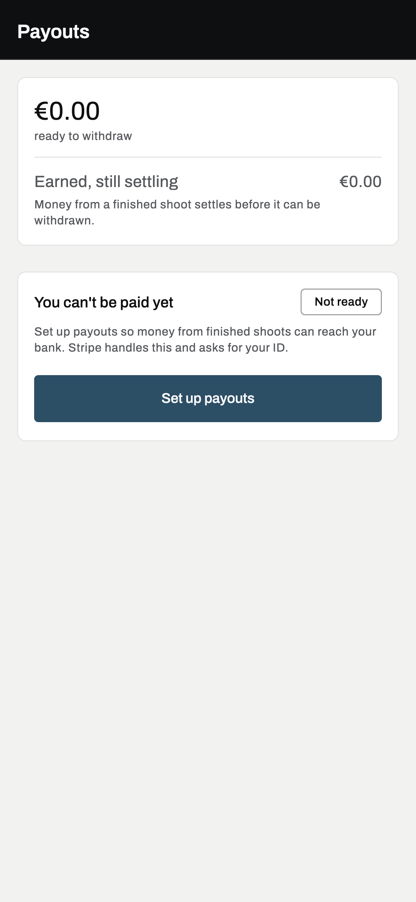
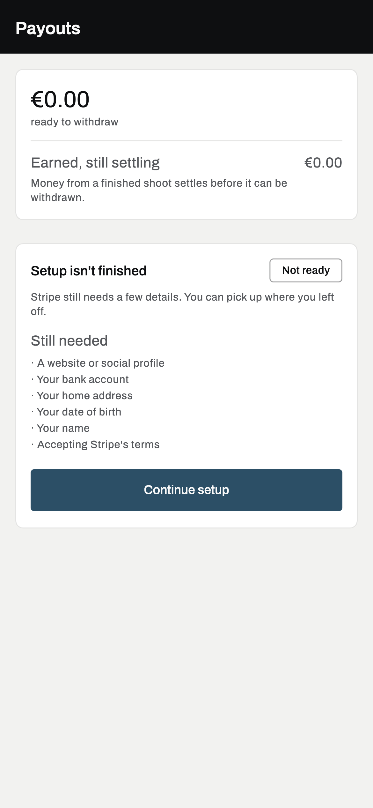
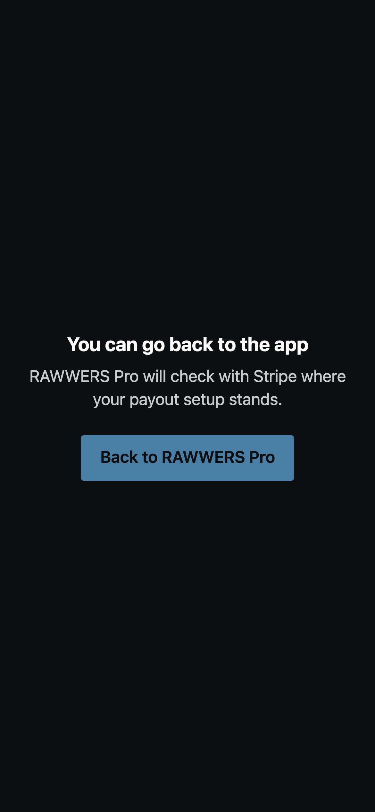
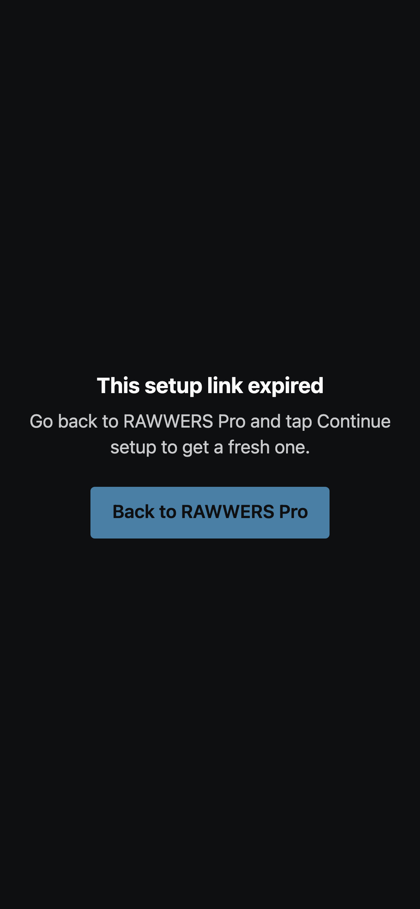
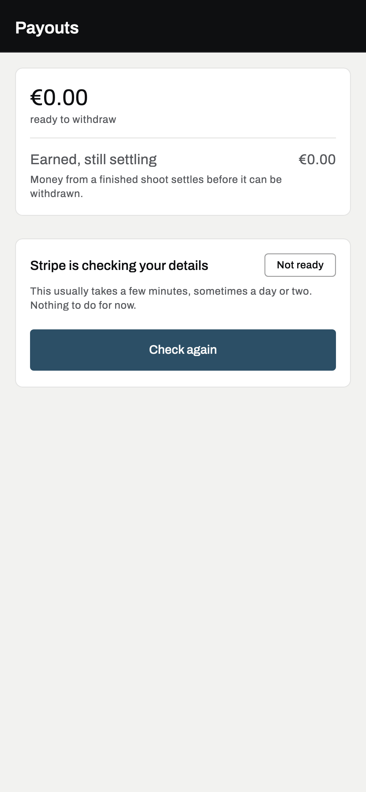
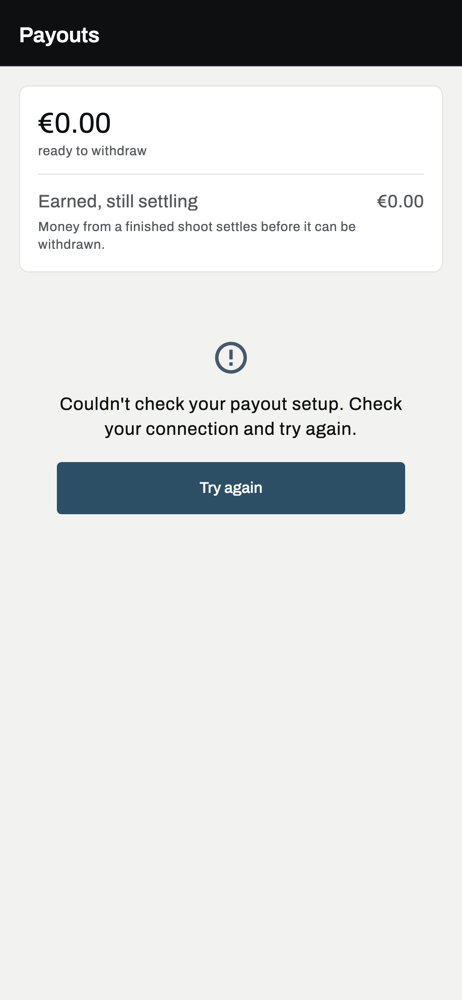
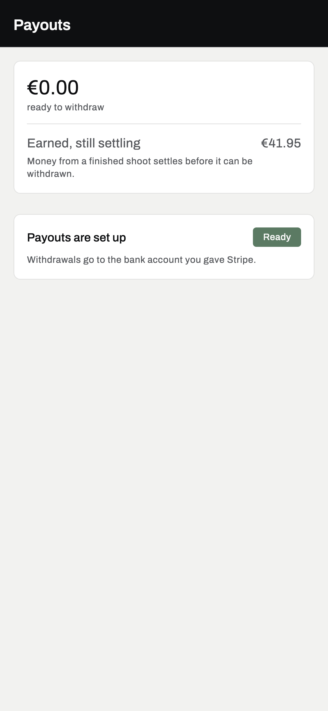
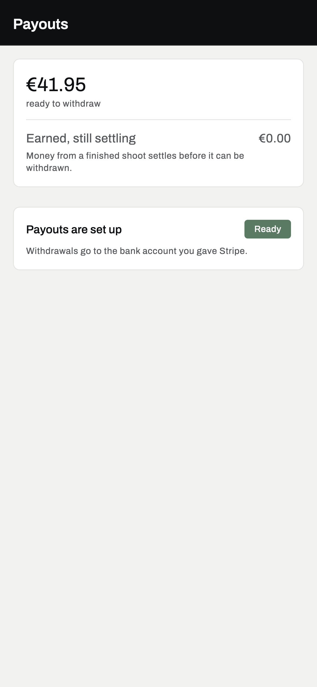
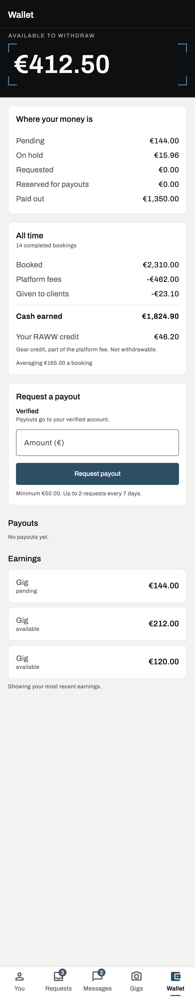
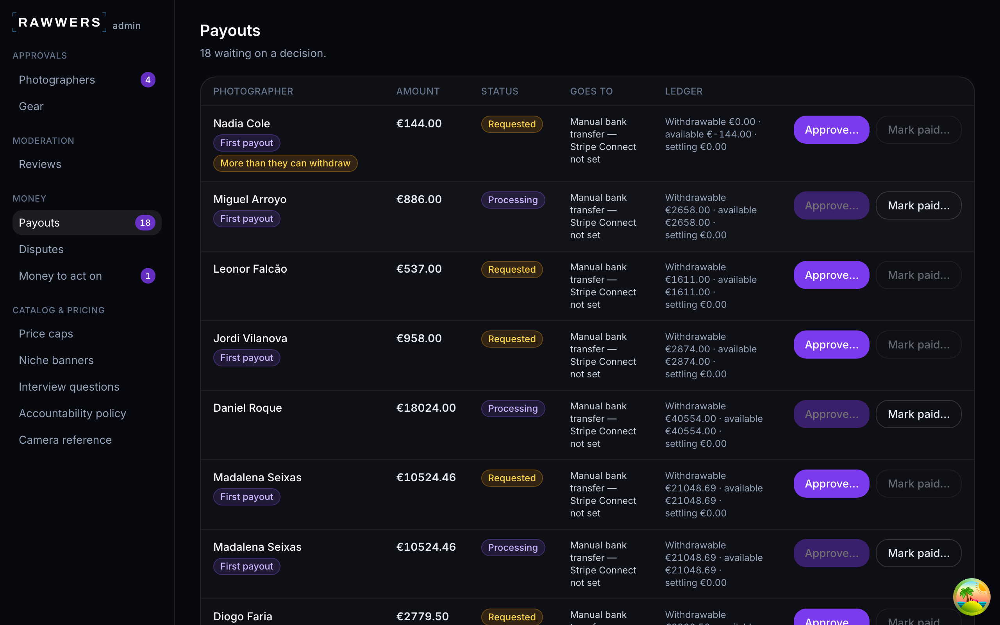

# Stage 1 loop: one full test booking, on the simulator, in Stripe test mode

A click-by-click checklist for the owner. One person plays both sides: **Alex Lens** (`pro1@rawwers.dev`, the pro app on the iPhone 17 simulator) and a **client** (`client@rawwers.dev`, the client app on the iPhone 17 Pro simulator). Dev logins use the password `Passw0rd!`. No real money moves and no real people are involved.

The loop: payout setup → booking request → accept → test-card payment → delivery → selection (the booking completes) → review → earnings settle → payout request → admin approval → transfer.

**How to use it.** Every step ends with **Expect:** what you should see, or the exact stored value. A step has passed when what you see matches. If it does not, stop there and report the step number, what you saw and the time - do not work around it.

**Stored values** are read with the read-only queries in the box at each check. Run them from `api/`. They print statuses and amounts, never secrets.

---

## 0. Before you start

### 0.1 Nothing else heavy is running

The loop must **not** run while an API test suite is running. On 2026-10-28 a suite, a Flutter build and two simulators together pushed the Mac's load average to about 200. The app's requests then timed out before reaching the API ("Could not load your earnings.", "Could not check your payout setup.") and Stripe's form took two minutes to load.

Check that no suite is running:

    docker ps --format '{{.Names}}' | grep api-api-run

**Expect:** no output, except the long-running demo presence refresher if you started it (it is light). If a suite *is* running and must not be stopped, lower its priority first and keep it lowered during the loop:

    # the suite's pytest process (the container name is the api-api-run-... line above)
    docker exec <container> sh -c 'for d in /proc/[0-9]*; do case "$(tr "\0" " " < $d/cmdline 2>/dev/null)" in *pytest*) renice -n 19 -p ${d#/proc/};; esac; done'
    # its database connections (run again if the suite opens new ones)
    for p in $(docker exec api-postgres-1 psql -U postgres -At -c "select pid from pg_stat_activity where datname like 'rawwers\_%\_test'"); do docker exec -u postgres api-postgres-1 renice -n 19 -p $p; done

Also: no Flutter builds or Flutter suites during the loop.

### 0.2 The dev stack

    cd api
    docker compose up -d
    docker compose ps --format '{{.Service}} {{.Status}}'

**Expect:** `api` (healthy), `worker`, `beat`, `postgres` (healthy), `redis` (healthy) all `Up`.

The dev API must be built from this branch (it bakes the code into the image). After pulling, or if unsure:

    docker compose build api worker && docker compose up -d --no-deps api worker

Check it serves this branch's status endpoint shape and the return pages:

    curl -s -o /dev/null -w '%{http_code}\n' "http://$(scutil --get LocalHostName).local:8000/v1/payouts/connect/return"

**Expect:** `200`.

`api/.env` (dev, untracked) must point `CONNECT_RETURN_URL` and `CONNECT_REFRESH_URL` at the Mac's `.local` address on port 8000 (`http://<this Mac>.local:8000/v1/payouts/connect/return` and `/refresh`). Check by name only:

    grep -cE '^CONNECT_(RETURN|REFRESH)_URL=http://.*\.local:8000/v1/payouts/connect/(return|refresh)$' .env

**Expect:** `2`.

### 0.3 Stripe webhook forwarding

`stripe listen` forwards Stripe's test-mode events (payments, transfers, and `account.updated` from connected accounts) to the dev API. It reads the test key from `api/.env` through the environment, so the key never appears on a command line; the `grep` hides the signing secret it prints.

    cd api
    STRIPE_API_KEY="$(grep -E '^STRIPE_SECRET_KEY=' .env | cut -d= -f2-)" \
      stripe listen \
        --events payment_intent.succeeded,payment_intent.payment_failed,payment_intent.canceled,charge.refunded,charge.refund.updated,refund.created,refund.updated,refund.failed,charge.dispute.created,transfer.created,transfer.reversed,account.updated \
        --forward-to localhost:8000/v1/webhooks/stripe \
        --forward-connect-to localhost:8000/v1/webhooks/stripe \
      2>&1 | grep --line-buffered -v whsec_

Leave it running in its own terminal.

**Expect:** `Getting ready...`, then nothing until events arrive (the `Ready!` line contains the secret and is hidden). During the loop each event shows as a `-->` line followed by `<-- [200] POST http://localhost:8000/v1/webhooks/stripe`. A `[400]` means the signing secret it uses differs from `STRIPE_WEBHOOK_SECRET` in `api/.env`; it matched on 2026-10-28.

The key in `api/.env` must be a test key (it starts with `sk_test_`). Check without printing it:

    grep -cE '^STRIPE_SECRET_KEY=sk_test_' .env

**Expect:** `1`. If it prints `0`, stop: never run the loop with a live key.

### 0.4 Dev only: settle earnings at once

> **DEV DATA CHANGE ONLY. NEVER DO THIS IN PRODUCTION. RESTORE IT AFTER THE LOOP (step 12).**
>
> Earnings normally wait `settlement_delay_days` (7) before they can be withdrawn. For the loop we set it to 0 on the dev database, so the booking's earning can be paid out the same evening.

The web admin has **no screen** for the fee policy. Its API (`PUT /v1/admin/finance/fee-policy`) replaces **every** fee field it takes, so changing only the delay safely means: read the whole policy, save it, change that one field, send every field back, and read it again to check. `docs/stage1-loop/fee_policy_delay.py` does exactly that, and `restore` (step 12.1) puts the saved values back the same way.

- **Safeguards:** it accepts only a dev API (localhost or a `.local` host), and it refuses to run twice without a restore in between.
- **What it asks for:** the admin password (`Passw0rd!`), which is not echoed. The admin API key is read from `web/.env.local` into the environment, so it never appears on a command line. No key, password or token is ever printed.
- **The saved copy:** `~/.rawwers/fee-policy-before-stage1-loop.json`, outside the repo. It holds only fee percentages and day counts, no secrets.

First, the whole row as it is now (one row; this includes three columns the API does not touch). Keep this output: step 12.1 compares against it.

    cd api
    docker compose exec -T postgres psql -U postgres -d rawwers -At -c "select id, fee_percent_gigs, fee_percent_extras, fee_percent_studioverse, settlement_delay_days, dispute_hold_days, retained_percent, pro_raww_percent, max_client_credit_percent from platform_fee_policy"

**Expect:** one line, `<id>|20|20|20|7|14|15|5|10` on 2026-10-29.

Then set the delay to 0 (from the repo root):

    cd ..
    RAWWERS_ADMIN_API_KEY="$(grep -E '^ADMIN_API_KEY=' web/.env.local | cut -d= -f2-)" \
      python3 -I docs/stage1-loop/fee_policy_delay.py set0

**Expect:**

    Password for admin@rawwers.dev:
    before: fee_percent_gigs=20, fee_percent_extras=20, fee_percent_studioverse=20, settlement_delay_days=7, dispute_hold_days=14
    saved to /Users/<you>/.rawwers/fee-policy-before-stage1-loop.json
    now: fee_percent_gigs=20, fee_percent_extras=20, fee_percent_studioverse=20, settlement_delay_days=0, dispute_hold_days=14
    OK: settlement_delay_days is 0, every other field unchanged.

Any line starting `STOP:` means nothing more was changed after that point. Read the message, and do not carry on with the loop until it is resolved.

Do this **before step 6**: an earning's "available from" time is fixed when it is recorded (when the client confirms their selection), from the delay in force at that moment. An earning recorded while the delay was 7 keeps its 7 days.

### 0.5 The simulators

    xcrun simctl boot 53D5B612-E29B-4180-828E-24DCF3325C03   # iPhone 17: pro app
    xcrun simctl boot BE71B153-80FA-4330-AE99-C790F6A62E07   # iPhone 17 Pro: client app
    open -a Simulator

Both apps must be built from this branch. The pro app at least must include B2 and B3 (the payout return link and the setup states):

    cd app
    flutter build ios --simulator --debug --flavor pro -t lib/main_pro.dart --dart-define-from-file=env/pro.json
    xcrun simctl install 53D5B612-E29B-4180-828E-24DCF3325C03 "build/ios/iphonesimulator/RAWWERS Pro.app"
    flutter build ios --simulator --debug --flavor client -t lib/main_client.dart --dart-define-from-file=env/client.json
    xcrun simctl install BE71B153-80FA-4330-AE99-C790F6A62E07 build/ios/iphonesimulator/RAWWERS.app

(Do this before step 0.1's "nothing heavy" applies - each build takes a few minutes and loads the Mac.)

**Expect:** both apps open on their sign-in screen or, if already signed in, on You (pro) and Discover (client).

---

## 1. Payout setup (the pro)

On the **iPhone 17**, in **RAWWERS Pro**, signed in as `pro1@rawwers.dev`.

**1.1** Tap **You**, then the gear icon (**Settings**), then **Getting paid**.

**Expect** one of these on the Payouts screen:

| What it says | Means | Next |
|---|---|---|
| **Payouts are set up**, chip **Ready** | pro1 finished onboarding (it did on 2026-10-28) | Skip to **1.5** |
| **You can't be paid yet** · button **Set up payouts** | no Stripe account yet | 1.2 |
| **Setup isn't finished** · **Still needed** list · **Continue setup** | started, not submitted | 1.2 |

 

**1.2** Tap **Set up payouts** (or **Continue setup**). Stripe's form opens in a sheet *inside* the app.

**Expect:** a Stripe page titled for RAWWERS, in a sheet with **Done** at the top. Stay in the sheet: **do not tap the compass ("Open in Safari") button** - Stripe's setup links work once, and reopening one in Safari lands on "This setup link expired" (seen on 2026-10-28).

**1.3** Fill in Stripe's test-mode form (values from Stripe's test-mode documentation; any other test value works the same):

| Field | Enter |
|---|---|
| Phone | `000 000 0000`, SMS code `000000` (or tap Stripe's "Use test code") |
| Email | any address |
| Name | any |
| Date of birth | `01/01/1901` (verifies instantly in test mode) |
| Address line 1 | `address_full_match`, any Lisbon city and postcode |
| ID number, if asked | `000000000` |
| Website, if asked | `https://accessible.stripe.com` |
| Bank (IBAN) | `PT50000201231234567890154` |

Accept and submit. Work steadily: a setup link left open for about 13 minutes expired twice on 2026-10-28. If you see **This setup link expired**, tap **Back to RAWWERS Pro**, then **Continue setup** for a fresh one.

**1.4** Stripe shows its last page, then **You can go back to the app**. Tap **Back to RAWWERS Pro**, then **Open**.

 

**Expect:** the sheet closes and you are back on the **same Payouts screen** (never an error page). The setup card shows a moment's spinner on its button, then **Payouts are set up** with **Ready**. If Stripe is still checking, it says **Stripe is checking your details** - wait a minute and tap **Check again**.

If it says **Couldn't check your payout setup. Check your connection and try again.**, tap **Try again** (Stripe calls from this network sometimes take 10-20 seconds).

 

**1.5 Check: the screen and the stored status agree.**

    docker compose exec -T postgres psql -U postgres -d rawwers -At -c "select pa.status, pa.payout_method from payout_account pa join user_account u on u.user_id = pa.pro_user_id where u.email = 'pro1@rawwers.dev'"

**Expect:**

| Payouts screen | Stored (`status|payout_method`) |
|---|---|
| **Payouts are set up**, **Ready** | `active|stripe_connect` |
| **Stripe is checking your details** | `pending_verification|stripe_connect` |
| **Setup isn't finished** / **Stripe needs something else from you** | `pending_verification|stripe_connect` |

**If the screen and the stored value do not match this table, STOP the loop and report both.** They come from one server mapping, so a mismatch is a bug, not a timing issue (the screen re-reads Stripe each time it opens, and stores what it reads).

Continue only with **Ready** / `active`.

---

## 2. Booking request (the client)

On the **iPhone 17 Pro**, in **RAWWERS**, signed in as `client@rawwers.dev`.

**2.1** On **Discover**, find **Alex Lens** (search, or a city row) and open the profile.

**2.2** Pick a package and tap **Request this package**. Pick a date and time from the calendar, fill **Where is the shoot?**, and tap **Send request**.

Choose a package whose price is **at least €15**: payouts start at €50.00, Alex already has €41.95 ready to withdraw, and roughly a quarter of the price goes to the platform fee and credits.

**Expect:** the request is sent and appears under **Bookings** as waiting for the photographer.

---

## 3. Accept (the pro)

**3.1** In RAWWERS Pro, tap **Requests**. The new request is at the top. Tap **Accept**.

**Expect:** the request moves to accepted.

    docker compose exec -T postgres psql -U postgres -d rawwers -At -c "select g.status from gig g join user_account u on u.user_id = g.pro_user_id where u.email = 'pro1@rawwers.dev' order by g.created_at desc limit 1"

**Expect:** `accepted` or `payment_pending`.

---

## 4. Payment (the client)

**4.1** In RAWWERS, tap **Bookings**, open the booking. It says **Payment due**. Tap **Pay now**.

**4.2** In Stripe's payment sheet, enter card **`4000 0000 0000 0077`**, expiry any future date (e.g. `12/34`), CVC `123`, any postcode. Pay.

This test card puts the money straight into the platform's *available* test balance, so the transfer in step 10 has funds.

**Expect:** **Payment sent. This updates as soon as it clears.**, then the booking shows as confirmed. In the `stripe listen` terminal: `--> payment_intent.succeeded` and `<-- [200]`.

    docker compose exec -T postgres psql -U postgres -d rawwers -At -c "select g.status from gig g join user_account u on u.user_id = g.pro_user_id where u.email = 'pro1@rawwers.dev' order by g.created_at desc limit 1"

**Expect:** `paid`. The money is now held by the platform; nothing is in Alex's Wallet yet.

---

## 5. Delivery (the pro)

**5.1** In RAWWERS Pro, tap **Gigs**, open the new gig, then **Deliver photos**.

**5.2** Tap **Add photos** and pick several from the simulator's photo library (it has sample photos). Wait until none says **Processing**.

**5.3** Tap **Send to client**, and confirm **Send these to your client?**.

**Expect:** the gallery shows as **Delivered**.

---

## 6. Selection (the client) - the booking completes here

Step 0.4 (delay 0) must be done before this step.

**6.1** In RAWWERS, open the booking under **Bookings**. Tap **Choose your photos**.

**6.2** Tap photos to choose them. Choose **no more than the package includes**: the button then reads **Confirm selection**, not **Pay €…** (choosing more asks for an extra payment, which is fine but adds steps).

**6.3** Tap **Confirm selection**, then confirm **Confirm your selection?**.

**Expect:** the booking shows the photos as yours to keep (**View your photos**).

    docker compose exec -T postgres psql -U postgres -d rawwers -At -c "select g.status from gig g join user_account u on u.user_id = g.pro_user_id where u.email = 'pro1@rawwers.dev' order by g.created_at desc limit 1"
    docker compose exec -T postgres psql -U postgres -d rawwers -At -c "select e.status, e.net_eur, e.available_at <= now() as due from earnings_ledger_entry e join user_account u on u.user_id = e.pro_user_id where u.email = 'pro1@rawwers.dev' order by e.created_at desc limit 1"

**Expect:** `completed`, then `pending|<net amount>|t` - Alex's earning exists, is still pending, and is already due (`t`) because the delay is 0. If the last column is `f`, step 0.4 was done too late: the earning waits 7 days; the loop cannot finish tonight.

---

## 7. Review (the client)

**7.1** In the booking, tap **Leave a review**, choose a rating, optionally write **What was it like?**, tap **Post review**.

**Expect:** the review shows on the booking.

---

## 8. Earnings settle

The settlement sweep runs on `beat` every hour. To run it now (the same task, run once):

    docker compose exec -T worker python -c "from app.tasks.payouts_tasks import run_settlement_scan_task as t; print('settled:', t())"

**Expect:** `settled: 1` (or more). Then:

    docker compose exec -T postgres psql -U postgres -d rawwers -At -c "select e.status from earnings_ledger_entry e join user_account u on u.user_id = e.pro_user_id where u.email = 'pro1@rawwers.dev' order by e.created_at desc limit 1"

**Expect:** `available`.

**8.1** In RAWWERS Pro, open **You → Settings → Getting paid** and pull down to refresh.

**Expect:** the top card's **ready to withdraw** amount is €41.95 plus this booking's net; **Earned, still settling** is €0.00; the setup card still says **Payouts are set up**.

 

*(Screenshots from the test harness: the second shows €41.95, the balance before this loop's booking.)*

---

## 9. Payout request (the pro)

**9.1** Tap **Wallet**. Scroll to **Request a payout**.

**Expect:** **Verified · Payouts go to your verified account.**, an **Amount (€)** field and a **Request payout** button. If instead it says payouts start at €50.00, the balance is under the minimum: book again (step 2).

*(Harness screenshot with fixture amounts; the card at the bottom is the one to use.)*

**9.2** Enter an amount between €50.00 and the amount available to withdraw. Tap **Request payout**.

**Expect:** the request is accepted; **Requested** in the Wallet shows that amount.

    docker compose exec -T postgres psql -U postgres -d rawwers -At -c "select pr.status, pr.amount_eur from payout_request pr join user_account u on u.user_id = pr.pro_user_id where u.email = 'pro1@rawwers.dev' order by pr.created_at desc limit 1"

**Expect:** `requested|<the amount>`.

---

## 10. Admin approval (the web admin)

**10.1** Start the web admin (in `web/`): `npm run dev`. Open `http://localhost:3000/login`.

**10.2** Sign in as `admin@rawwers.dev` / `Passw0rd!` and tap **Login**.

**10.3** In the sidebar, under **MONEY**, click **Payouts**. The page lists withdrawal requests; the dev data includes many seeded demo requests.

**10.4** Find the row for **Alex Lens** with the amount from 9.2.

**Expect on that row:** status **Requested**; **GOES TO** reads **Stripe Connect — active**. If it reads *Manual bank transfer*, or anything other than `active`, stop: approving would not send money to Stripe.

Do **not** approve any other row: the seeded demo requests are manual bank transfers.

**10.5** Click **Approve…** on Alex's row. The dialog reads **Approve €<amount> to Alex Lens?** and **Stripe Connect — active.** Click **Approve €<amount>**.

**Expect:** the row's status changes to **Approved**, and within a few seconds (the worker sends the transfer) to **Paid**. In the `stripe listen` terminal: `--> transfer.created` and `<-- [200]`.

Do **not** click **Mark paid…**: that is for manual bank transfers, where no money moves through Stripe.

    docker compose exec -T postgres psql -U postgres -d rawwers -At -c "select pr.status, pr.reference->>'stripe_transfer_id' is not null as has_transfer, pr.failure_reason from payout_request pr join user_account u on u.user_id = pr.pro_user_id where u.email = 'pro1@rawwers.dev' order by pr.created_at desc limit 1"

**Expect:** `paid|t|` - paid, with a Stripe transfer id, and no failure reason. If it says `failed|f|<reason>`, stop and report the reason (it is Stripe's own message; no secret in it).

---

## 11. After the payout: the screen and the stored status agree

**11.1** In RAWWERS Pro, open **Wallet** and pull down.

**Expect:** **Paid out** has grown by the amount; **Requested** is back to €0.00.

**11.2** Open **You → Settings → Getting paid** and pull down.

**Expect:** **Payouts are set up**, chip **Ready**; **ready to withdraw** has dropped by the amount paid.

    docker compose exec -T postgres psql -U postgres -d rawwers -At -c "select pa.status, pa.payout_method from payout_account pa join user_account u on u.user_id = pa.pro_user_id where u.email = 'pro1@rawwers.dev'"

**Expect:** `active|stripe_connect`.

**If the Payouts screen says anything other than Payouts are set up, or the stored status is not `active`, STOP and report both.**

---

## 12. Put dev back

**12.1 Restore the fee policy** to exactly what was saved in 0.4 (from the repo root):

    RAWWERS_ADMIN_API_KEY="$(grep -E '^ADMIN_API_KEY=' web/.env.local | cut -d= -f2-)" \
      python3 -I docs/stage1-loop/fee_policy_delay.py restore

**Expect:** the `saved`, `before restore` and `now` lines, then `OK: the fee policy is back to the saved values.` The `now` line must match `saved` field for field. If it says `STOP: since the save, these changed too: ...`, something else changed the policy during the loop: it has not overwritten it. Report that and do not fix it by hand.

Then the whole row again, from `api/`:

    docker compose exec -T postgres psql -U postgres -d rawwers -At -c "select id, fee_percent_gigs, fee_percent_extras, fee_percent_studioverse, settlement_delay_days, dispute_hold_days, retained_percent, pro_raww_percent, max_client_credit_percent from platform_fee_policy"

**Expect:** exactly the line you kept from 0.4.

**12.2** Stop `stripe listen` (Ctrl-C) and the web admin's `npm run dev`.

Nothing else was changed outside the apps' own flows.

---

## What the screenshots could and could not show

The screenshots above come from two places: the Payouts screen states and the Wallet from the app's screenshot harness (`app/test/screenshots/`), with test data, not the dev database; the return pages and the admin Payouts queue from a headless browser against the dev stack on 2026-10-28.

**Not reached (no screenshot):** I cannot tap the simulators, so these are described from the code and from the owner's gate run, not shown:

- Stripe's hosted onboarding form (1.3) and the iOS **Open in "RAWWERS Pro"?** prompt (1.4);
- the client app's booking request, payment sheet, delivered gallery, selection and review (steps 2, 4, 6, 7);
- the pro app's Requests, Gigs and delivery screens with *this loop's* booking (steps 3, 5);
- the admin's Approve dialog and Alex's row (10.4-10.5) - the queue screenshot shows only seeded demo requests;
- the Wallet and Payouts screens with this loop's real amounts (8.1, 9, 11).
